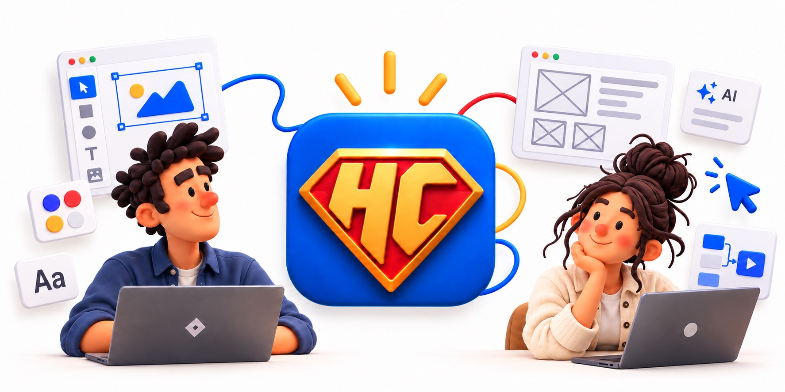
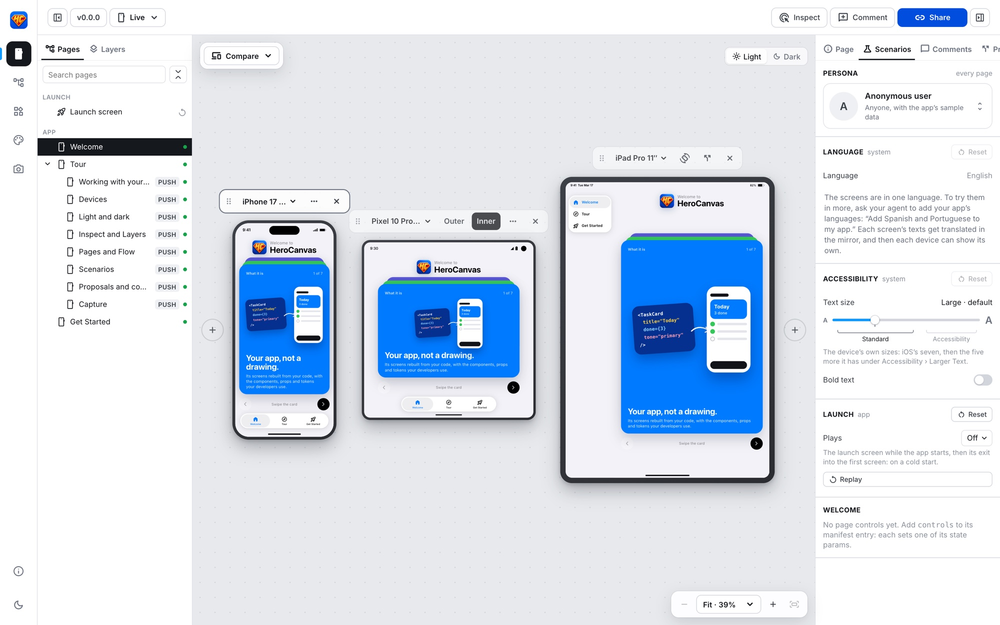
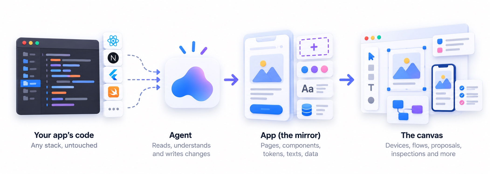
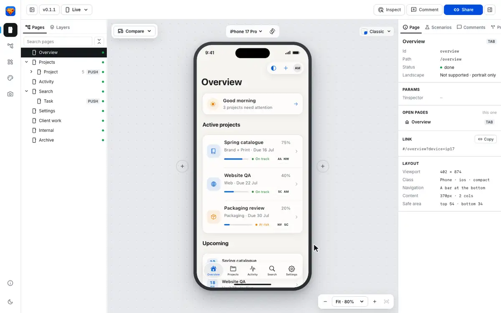
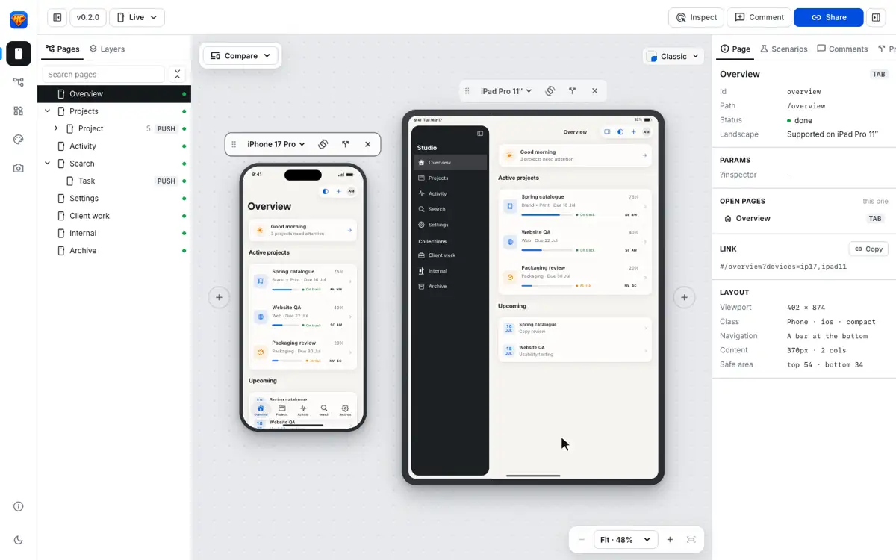
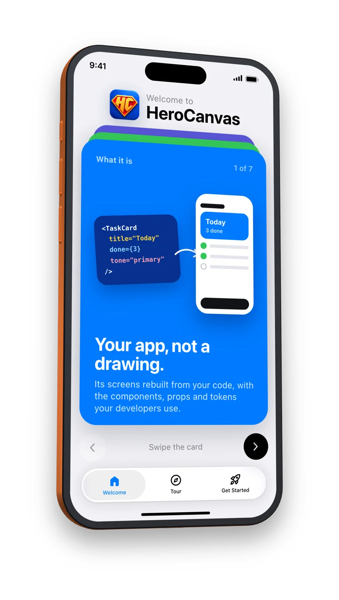

<p align="center"></p>

# HeroCanvas

### Superpowers for Designers

<a href="src/CHANGELOG.md"></a>
<a href="LICENSE"></a>

<a href="https://github.com/santiquiss/HeroCanvas/actions/workflows/checks.yml"></a>
<a href="https://github.com/santiquiss/HeroCanvas/discussions"></a>
<a href="https://github.com/sponsors/santiquiss"></a>
<a href="https://herocanvas.io"></a>

**Design your app’s screens with an AI agent, on a canvas of real devices.**

HeroCanvas shows your app's screens on every device at once — phones, foldables, iPads, in light and dark, in every
language — with the navigation, sheets, keyboard and accessibility text sizes behaving as they will in the app. The
screens aren't drawings: they're a **mirror** of your app, rebuilt from its code with the same components, props and
tokens your developers use. Then you design changes on top of it as **proposals**, compare them with the app as it
is, and hand them off with a specification written in your code's terms.

It's made to be used **with an AI coding agent** (Claude Code, or any agent that reads `AGENTS.md`). You don't wire it
up by hand: you point the agent at your app and ask. The agent reads your app's code, builds the mirror, and keeps it
honest; you look at the canvas, try the scenarios, and say what to change.

<p align="center"><br>
<sub>One screen on an iPhone, a foldable and an iPad at once, with the app's pages and the scenarios to try it in.</sub></p>

**[Try it live](https://herocanvas.io/examples/studio/)**: the real HeroCanvas in your browser, with a SwiftUI app mirrored (tabs on
the iPhone, a sidebar and an inspector on the iPad, three themes) and [a proposal](https://herocanvas.io/examples/studio/#/projects?devices=ip17,ipad11&proposal=PS-1)
to compare. More on the [website](https://herocanvas.io).

<p align="center"></p>

> [!WARNING]
> **HeroCanvas is in beta.** It works today, and it's changing fast. Expect rough edges, and changes to how your copy
> plugs in, until 1.0. Update on purpose, and read the [changelog](src/CHANGELOG.md) first: each release says what to
> adapt. Until you connect your app, HeroCanvas shows its own **tour**; connecting your app works through the agent,
> for any stack (React, React Native, Flutter, SwiftUI, Compose). Dedicated connectors per stack are next: see
> [Developer experience](docs/developer-experience.md).

## Why not just Figma?

Figma is a great place to explore. But once an app exists, a Figma file is a **drawing of it**: it drifts from the
code, it can't show what the code does, and every design has to be rebuilt by hand to ship. HeroCanvas designs on the
app itself.

| | A Figma file | HeroCanvas |
|---|---|---|
| **What you design on** | A drawing that drifts from the app | A mirror of the app, rebuilt from its code |
| **Components** | Copies of the real ones, out of sync over time | The code's components, with their names and props |
| **Devices** | One frame per size, drawn by hand | Every phone, foldable and tablet at once, at real size, with safe areas, keyboard and navigation |
| **States and data** | Static mockups of a few cases | Personas, languages, text sizes, light and dark, a page's states: switched live, each one a link |
| **Behavior** | Prototypes that fake it | Real navigation, sheets, menus and dialogs that behave as the app's do |
| **Handoff** | Specs a developer translates into code | Proposals in the code's own terms: component names, props, tokens |
| **How you change it** | By hand, frame by frame | By asking your AI agent, in words, with screenshots, references or Figma links |
| **Accessibility** | Checked by eye | Large text sizes and Bold Text applied to every screen: where a layout breaks shows |

**Figma still has its place.** Use it to sketch something new, or as a source: HeroCanvas can start from a Figma file
before there's code, and your agent can read a frame you link to turn it into components on the canvas.

### How it compares

| | Figma | Storybook | AI app builders<br><sub>(v0, Lovable, Bolt…)</sub> | Xcode / Android Studio previews | **HeroCanvas** |
|---|:-:|:-:|:-:|:-:|:-:|
| Designs on your app's real components | — | ✓ | — | ✓ | ✓ |
| Your existing app, any stack | — | ◐ | — | — | ✓ |
| Whole screens with their navigation and flows | ◐ | — | ✓ | — | ✓ |
| Every phone, foldable and tablet at once, at real size | ◐ | — | — | ◐ | ✓ |
| Personas, languages, text sizes, themes switched live | ◐ | ◐ | — | ◐ | ✓ |
| Changes in versions to compare, kept apart from the app | ◐ | — | ◐ | — | ✓ |
| Handoff in your code's own terms | ◐ | ◐ | — | — | ✓ |
| Changed by asking an AI agent | ◐ | — | ✓ | ◐ | ✓ |
| Comments for the whole team on the screens | ✓ | — | ◐ | — | ✓ |
| Images and videos of the screens, the device in 3D | ◐ | — | — | ◐ | ✓ |
| Tried on a real phone, installed as an app | ◐ | ◐ | ◐ | ✓ | ✓ |

<sub>✓ yes · ◐ partly, or with extra setup · — no. Storybook shows components one by one; AI app builders make a new app
in their own stack, not yours; native previews show one view of one platform at a time.</sub>

## How it works

<p align="center"></p>

1. **The mirror** (`app/`) is your app as it is today: one page per screen, your components with their names and
   props, your tokens as `--app-*` variables, your texts in every language, and sample data for each persona.
2. **The tool** (`src/`) reads only the mirror and knows nothing else about your app, so it works the same for any app,
   and its updates never touch your work.
3. **Proposals** (`proposals/`) are changes to the mirror, kept apart: new pages, replaced components, versions A
   and B to compare, and a `handoff.md` for whoever builds it.

## The story

HeroCanvas was born inside **[MacrosFirst](https://macrosfirst.com)**, a macro tracker and meal planner used every day
by people all over the world, on iPhone and Android ([App Store](https://apps.apple.com/us/app/macrosfirst/id1253012487) ·
[Google Play](https://play.google.com/store/apps/details?id=com.ha.prepsmart)).

We set out to design MacrosFirst for **foldables**: phones that open into a tablet, with two screens, hinges and
layouts that change as you fold them. No design tool could show that honestly. A Figma frame can't fold, can't keep
the app's real navigation, and can't tell you what the code will actually do on a Galaxy Z Fold or a Pixel Fold. So
we built our own canvas: MacrosFirst's screens, rebuilt from its code, on every device at once, with an AI agent doing
the building.

It kept growing. Every phone, tablet and foldable; light and dark; every language; personas and text sizes;
proposals to compare; Inspect, comments and handoffs in the code's own terms. It became the way we design MacrosFirst,
and something we couldn't imagine working without. Then we took out everything specific to MacrosFirst, made it work
for any app and any stack, and shared it with the world.

If HeroCanvas helps you, give [MacrosFirst](https://macrosfirst.com) a try: it's where all of this started.

## Get started

You need [Node.js](https://nodejs.org) 20 or newer, git, and an AI coding agent —
HeroCanvas is tested with [Claude Code](https://claude.com/claude-code).

### 1. Get your copy

Make it your own repository (click **Use this template** on GitHub, or fork it), then clone it:

```
git clone https://github.com/<you>/<your-herocanvas>.git
cd <your-herocanvas>
npm install
```

Your copy will hold your app's mirror and your proposals: it's where your team designs.

### 2. Take the tour

```
npm run dev
```

Open the address it prints. With no app connected yet, the devices show HeroCanvas's own **tour**, an iOS-style app
in three tabs: **Welcome** (what HeroCanvas is, its goal, how it works), **Tour** (a page per part of HeroCanvas, each
with something to try on the interface around the device: devices, themes, Inspect and Layers, Pages and Flow,
Scenarios, proposals, Capture) and **Get Started** (how to connect your app). Every part of HeroCanvas works on it;
connecting your app replaces it.

### 3. Make it yours

`herocanvas.config.ts`, at the root: the tool's name and logo (a square PNG), and its interface's language
(`language: 'es'` for Spanish). The favicon, the home-screen icons and
the brand color come from the logo on their own (set the color there if you want another); restart `npm run dev`
after a change.

### 4. Connect your app

Open your agent in the repository and ask:

```
claude
> Connect my app to HeroCanvas. Its code is in ../my-app.
```

The agent follows the `connect-app` skill: it detects your stack, reads your routes, theme, navigation and texts, and
replaces the tour with your app's mirror — every screen as a placeholder page first. Then it mirrors the
screens one at a time, starting with the one you pick, and shows you each before the next. Your app's code is only
read, never changed.

### 5. Design

Talk to the agent about what you see on the canvas:

```
> Mirror the Settings screen.
> The empty state of Today looks wrong next to the app: compare and fix it.
> Propose a new onboarding with two versions: one with a video, one with three steps.
> On the iPad the list should open beside the detail. Make it a proposal.
> Write the handoff for the new onboarding, with screenshots on a phone and an iPad.
> Create two personas: an admin on the paid plan and someone who just signed up.
```

Share any view by its link (**Share**: the device, page, scenario and proposal are in the URL), leave **comments** on
the canvas, and export images or videos with **Capture**.

### 6. Stay in sync with your team

Deploy your copy once to any static host (Vercel, Netlify, Cloudflare Pages, GitHub Pages, your own servers). Every push
updates the link: designers, developers and reviewers open the same canvas, leave comments and review proposals, with
nothing to install. See [Deploy](#deploy-a-link-for-your-team).

## Working with the agent

`AGENTS.md` is the agent's guide to this codebase (Claude Code reads it through `CLAUDE.md`). Procedures it follows
step by step live in `.claude/skills/`:

| Skill | When |
|---|---|
| `connect-app` | The first time: your app's code becomes the mirror (settings, tokens, navigation, pages). |
| `mirror-screen` | A screen or component of your app, built or fixed to match its code. |
| `new-proposal` | A change to explore or hand off: pages, components, versions, the handoff spec. |
| `new-persona` | Someone to try the app as: it reads what changes the screens per user, asks you who they are, saves their data and photo. |
| `update-herocanvas` | A newer HeroCanvas into your copy, your code adapted to what changed. |

Other agents can read the same files: they're plain Markdown.

## What's in it

- **Canvas**: one device or many (a set, All devices), turned, zoomed, with the status bar, Dynamic Island or notch,
  home indicator and system keyboard of each.
- **Real navigation**: your pages by their manifest (tabs, pushed screens, modals, what comes before the tabs),
  list–detail on wide screens, tabs that become a sidebar on tablets, and one rule for sheets: an action sheet on a
  phone becomes a menu on an iPad, as in the app; a task is a dialog.
- **Launch**: the app's launch screen and its way into the first screen (screen, enter, hold, exit: the same four
  phases as iOS and Android), played on a cold start; Pages' Launch screen (or Scenarios' Replay) plays it again.
- **Pages, Flow, Scenarios**: every page and its variants; flows laid out step by step; personas, the language (right
  to left too), iOS and Android text sizes and Bold Text, and each page's own controls — all in the URL, so a
  scenario is a link to share.
- **Themes and tokens**: light and dark, or your app's own themes (Classic, Graphite, Stone…), picked from the canvas;
  the Tokens view lists every token with a column per theme.
- **The iOS kit** (`herocanvas/ios`): SwiftUI's own views (NavigationStack, List sections and rows, Picker, Menu,
  Toggle, searchable…) on your app's tokens, so a SwiftUI app's mirror doesn't rebuild the platform. The system
  keyboards of each device come built in.
- **Proposals**: changes kept apart, with versions to compare side by side and a handoff for whoever builds them.
- **Inspect, Layers, Components**: the component under the cursor with its props and tokens, the tree of components,
  and a gallery of every component and its states.
- **Comments**: notes for the whole team, right on the screens (kept in the browser, or shared through a Supabase
  table: `src/comments/supabase.sql`).
- **Capture**: any screen as an image or a video, the device turned in 3D with light and motion.
- **On a real phone**: open your deployed copy on a phone and install it from the browser (a PWA): your app's screens
  at their real size, in your hand.
- **Icons as your app draws them**: Material Symbols, or your app's SF Symbols and its own `.symbolset`s, made on a
  Mac with `npm run symbols` (`<Icon name="sf:box.truck" />`). HeroCanvas ships no SF Symbols: Apple's license lets
  you use them to design apps for its platforms, from your Mac's own copy.
- **Your app's assets in one command**: `npm run assets` (images and an asset catalog's colors) and `npm run texts`
  (translations from `.strings`, `.xcstrings`, `strings.xml`, ARB or i18next JSON), read from your app's repository.
- **Screenshots from the terminal**: `npm run shot -- "/today"` (light and dark, in device frames; `--device`,
  `--land`, `--compare` with a proposal; it finds this project's dev server on its own) — what the agent uses to look at its own work.

<p align="center"><br>
<sub><b>Inspect</b>: the component under the cursor, measured on the device, with its props, layout and tokens; Layers shows where it sits.</sub></p>

<p align="center"><br>
<sub><b>Scenarios</b>: every theme, text size and Bold Text, on every device at once; where a layout breaks shows.</sub></p>

<p align="center"><br>
<sub><b>Capture</b>: any screen as an image or a video, the device turned in 3D with light and motion, ready for a deck or a store page.</sub></p>

## Project layout

Like Laravel's skeleton and framework: some folders are yours, one is the tool's.

```
Yours                  HeroCanvas's updates never touch these
  app/                 your app's mirror: config.ts, pages.tsx, nav/, components/, screens/, data/, theme.css
  proposals/           changes to it, one folder each
  herocanvas.config.ts the tool's name, logo and brand color
  brand/               the logo

The tool's             don't edit: it's what updates replace (and, one day, an npm package)
  src/                 simulator, panels, Flow, gallery, Capture, comments, Inspect, the kit
  src/index.ts         its public API: all app/ and proposals/ import, as `from 'herocanvas'`
  scripts/, public/

docs/                  design notes (the developer experience)
.claude/skills/        procedures for the agent
```

React 19, React Router and Vite; no other runtime dependency.

## Updating

When HeroCanvas has a new version, ask your agent to **"update HeroCanvas"** (the `update-herocanvas` skill), or run it
yourself with your work committed:

```
npm run update -- --dry-run   # what it would change, and the changelog
npm run update                # the latest version (or: npm run update -- 0.6.0)
```

It replaces the tool's files (`src/`, `scripts/`, the configs: the list is `scripts/update/tool-files.json`), merges
any you changed with the new version and marks a clash for you to resolve, merges `package.json` keeping your own
scripts and dependencies, and prints the changelog. `app/`, `proposals/`, `herocanvas.config.ts` and `brand/` are
never touched; a **Contract** item in the changelog says what to adapt in them. Then `npm install` and the checks.
Versions come from this repository's tags, fetched with your git credentials; a fork: `--from <git url>`.

## Deploy: a link for your team

HeroCanvas builds into a plain static site, so it can live anywhere. Put it online and your whole team (designers,
developers, product, reviewers) opens the same canvas from a link: no install, nothing to run. Every link inside it
(a screen, a device, a scenario, a proposal) is shareable as it is.

```
npm run build        # the site, in dist/
```

**Vercel** (or any host like it, in a few clicks):

1. Push your copy to GitHub, then on [vercel.com](https://vercel.com) choose **Add New › Project** and import it.
2. Vercel detects Vite: the build command is `npm run build`, the output `dist`. Deploy.
3. That's it: every push to `main` updates the link, and each branch gets a preview link of its own (handy for a
   proposal under review).

**Netlify** and **Cloudflare Pages** work the same way (build `npm run build`, publish `dist`). **Your own stack**:
build anywhere (your CI, a Dockerfile) and serve `dist/` from any static server or bucket (nginx, S3 and CloudFront,
Firebase Hosting…). Links use the URL's hash, so no rewrite rules are needed, and it works at a domain's root
(`design.yourcompany.com`) or under a path.

**GitHub Pages**: in your repository, **Settings › Pages › Source: GitHub Actions**, then add
`.github/workflows/pages.yml`:

```yaml
name: Pages
on:
  push:
    branches: [main]
permissions:
  contents: read
  pages: write
  id-token: write
jobs:
  deploy:
    runs-on: ubuntu-latest
    environment: github-pages
    steps:
      - uses: actions/checkout@v4
      - uses: actions/setup-node@v4
        with:
          node-version: 22
      - run: npm ci && npm run build
      - uses: actions/upload-pages-artifact@v3
        with:
          path: dist
      - uses: actions/deploy-pages@v4
```

Each push to `main` publishes it at `https://<you>.github.io/<your-repo>/`. Pages on a private repository needs a
paid GitHub plan, and the site is public: for unreleased designs, prefer a host with access control.

Good to know:

- **It's a place to look, not to edit.** Changes are made where your agent runs, then pushed: the link updates on its
  own. Saving to project files works only with `npm run dev`.
- **Keep it private.** Your app's unreleased designs are on it: put the link behind your host's protection (Vercel's
  Deployment Protection, Netlify's password protection, Cloudflare Access) or your company's login.
- **Shared comments** need a database: until you connect one, each browser keeps its own. Ask your agent to set up
  Supabase with `src/comments/supabase.sql` and `src/comments/supabase.json`.

## Contribute

HeroCanvas is in beta and built in the open: feature requests, bugs and contributions all go through GitHub.

- **Request a feature**: open an issue with the [Idea template](https://github.com/santiquiss/HeroCanvas/issues/new?template=feature.yml): what you want to
  design and why. For a bigger change, we agree on its shape there before anyone builds it.
- **Report a bug**: open an issue with the [Bug template](https://github.com/santiquiss/HeroCanvas/issues/new?template=bug.yml): what you did, what you
  expected, and the link HeroCanvas shows for that screen.
- **Tell us where your app didn't connect**: a stack or a pattern the agent misreads is the most valuable report we
  get. A small public repository that shows it is even better.
- **Send a pull request**: fork it and make one change. [AGENTS.md](AGENTS.md) guides you or your agent;
  [CONTRIBUTING.md](CONTRIBUTING.md) has the checklist.
- **Sponsor it**: HeroCanvas is free and open source; [GitHub Sponsors](https://github.com/sponsors/santiquiss)
  keeps it moving.

## Develop HeroCanvas itself

`npm run typecheck`, `npm run lint`, `npm test`, `npx vite build` before a change is done; versions and the changelog
as `AGENTS.md` says. Ideas and fixes are welcome as issues and pull requests: [CONTRIBUTING.md](CONTRIBUTING.md).

## Versions

Two, each with its changelog. **Your copy's** (`package.json`, `CHANGELOG.md`): the changes to your mirror and
proposals, at the top left of HeroCanvas. **HeroCanvas's** (`src/version.json`, [`src/CHANGELOG.md`](src/CHANGELOG.md)):
the tool's, on its page (the ⓘ at the bottom of the left rail) with the license; updates bring it.

## License

Made by [Santiago Quiss](https://github.com/santiquiss) and [Agustina Salas](https://github.com/salasagustina-ds), in
collaboration with the [MacrosFirst](https://macrosfirst.com) team.

Open source under the [Apache License 2.0](LICENSE): use it, change it and share it, for yourself or your company,
commercially too. Any copy or project built from it keeps the license and the [`NOTICE`](NOTICE) file,
which names its creators. Your own code (`app/`, `proposals/`) is yours.
