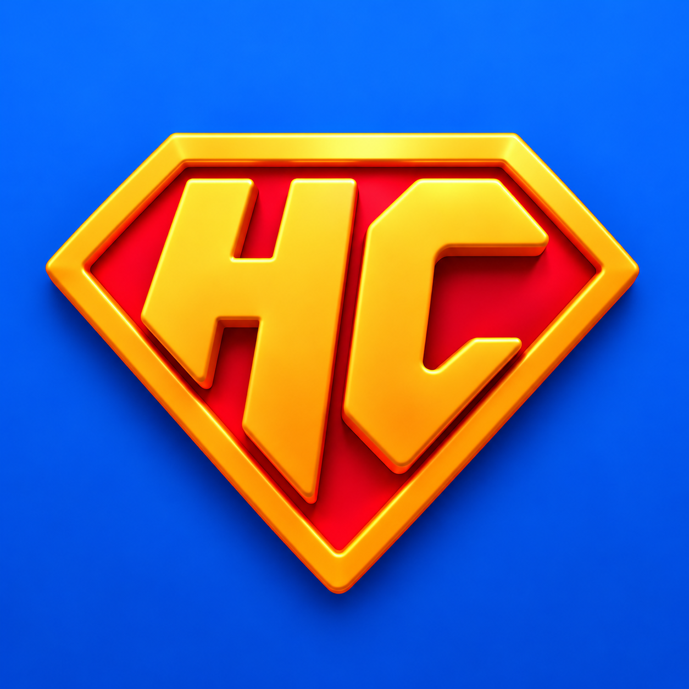

<p align="center"></p>

# HeroCanvas

<a href="src/CHANGELOG.md"></a>
<a href="LICENSE"></a>

**Design your app's screens in code, with an AI agent, on a canvas of real devices.**

HeroCanvas shows your app's screens on every device at once — phones, foldables, iPads, in light and dark, in every
language — with the navigation, sheets, keyboard and accessibility text sizes behaving as they will in the app. The
screens aren't drawings: they're a **mirror** of your app, rebuilt from its code with the same components, props and
tokens your developers use. Then you design changes on top of it as **proposals**, compare them with the app as it
is, and hand them off with a specification written in your code's terms.

It's made to be used **with an AI coding agent** (Claude Code, or any agent that reads `AGENTS.md`). You don't wire it
up by hand: you point the agent at your app and ask. The agent reads your app's code, builds the mirror, and keeps it
honest; you look at the canvas, try the scenarios, and say what to change.

> Early days. Until you connect your app, HeroCanvas shows its own **tour**, a small app that walks through every part
> of it. Connecting your own app works today through the agent (any stack: React, React Native, Flutter, SwiftUI, Compose); dedicated connectors
> per stack are next — see [Developer experience](docs/developer-experience.md).

## How it works

```
 your app's code ──read──▶  agent  ──writes──▶  app (the mirror)  ──▶  the canvas
 (any stack, untouched)     (Claude)            pages, components,          devices, flows, scenarios,
                                                tokens, texts, data         proposals, Inspect, comments
```

1. **The mirror** (`app/`) is your app as it is today: one page per screen at its route, your components with
   your names and props, your tokens as `--app-*` variables, your texts in every language, mock data per persona.
2. **The tool** reads only that mirror. It knows nothing about your app beyond it, so it works the same for any app.
3. **Proposals** (`proposals/`) are changes to the mirror, kept apart: new pages, replaced components, versions A
   and B to compare, and a `handoff.md` for whoever builds it.

## Get started

You need [Node.js](https://nodejs.org) 20 or newer, git, and an AI coding agent —
[Claude Code](https://claude.com/claude-code) is what HeroCanvas is tested with.

### 1. Get your copy

Make it your own repository (click **Use this template** on GitHub, or fork it), then clone it:

```
git clone https://github.com/<you>/<your-herocanvas>.git
cd <your-herocanvas>
npm install
```

Your copy will hold your app's mirror and your proposals: it's where your team designs.

### 2. Take the tour

```
npm run dev
```

Open the address it prints. With no app connected yet, the devices show HeroCanvas's own **tour**, an iOS-style app
in three tabs: **Welcome** (what HeroCanvas is, its goal, how it works), **Tour** (a page per part of HeroCanvas, each
with something to try on the interface around the device: devices, themes, Inspect and Layers, Pages and Flow,
Scenarios, proposals, Capture) and **Get Started** (how to connect your app). Every part of HeroCanvas works on it;
connecting your app replaces it.

### 3. Make it yours

`herocanvas.config.ts`, at the root: the tool's name and logo (a square PNG). The favicon, the home-screen icons and
the brand color come from the logo on their own (set the color there if you want another); restart `npm run dev`
after a change.

### 4. Connect your app

Open your agent in the repository and ask:

```
claude
> Connect my app to HeroCanvas. Its code is in ../my-app.
```

The agent follows the `connect-app` skill: it detects your stack, reads your routes, theme, navigation and texts, and
replaces the tour with your app's mirror — every screen as a placeholder page first. Then it mirrors the
screens one at a time, starting with the one you pick, and shows you each before the next. Your app's code is only
read, never changed.

### 5. Design

Talk to the agent about what you see on the canvas:

```
> Mirror the Settings screen.
> The empty state of Today looks wrong next to the app: compare and fix it.
> Propose a new onboarding with two versions: one with a video, one with three steps.
> On the iPad the list should open beside the detail. Make it a proposal.
> Write the handoff for PJ-2 and take screenshots of it on a phone and an iPad.
> Create two personas: an admin on the paid plan and someone who just signed up.
```

Share any view by its link (**Share**: the device, page, scenario and proposal are in the URL), leave **comments** on
the canvas, and export images or videos with **Capture**.

## Working with the agent

`AGENTS.md` is the agent's guide to this codebase (Claude Code reads it through `CLAUDE.md`). Procedures it follows
step by step live in `.claude/skills/`:

| Skill | When |
|---|---|
| `connect-app` | The first time: your app's code becomes the mirror (settings, tokens, navigation, pages). |
| `mirror-screen` | A screen or component of your app, built or fixed to match its code. |
| `new-proposal` | A change to explore or hand off: pages, components, versions, the handoff spec. |
| `new-persona` | Someone to try the app as: it reads what changes the screens per user, asks you who they are, saves their data and photo. |
| `update-herocanvas` | A newer HeroCanvas into your copy, your code adapted to what changed. |

Other agents can read the same files: they're plain Markdown.

## What's in it

- **Canvas**: one device or many (a set, All devices), turned, zoomed, with the status bar, Dynamic Island or notch,
  home indicator and system keyboard of each.
- **Simulator**: your pages by their manifest (tabs, pushed pages, covers, what comes before the tabs), list–detail on
  wide screens, and one rule for sheets: an action sheet on a phone is a menu hanging from its button on an iPad, a
  task is a dialog.
- **Launch**: the app's launch screen and its way into the first screen (screen, enter, hold, exit: the same four
  phases as iOS and Android), played on a cold start; Pages' Launch screen (or Scenarios' Replay) plays it again.
- **Pages, Flow, Scenarios**: every page and its variants; flows laid out step by step; personas, the language, the
  system's text size and Bold Text, and each page's own controls — all in the URL, so a scenario is a link.
- **Proposals**: changes kept apart, with versions to compare side by side and a handoff for whoever builds them.
- **Inspect, Layers, Components**: the component under the cursor with its props and tokens, the tree of components,
  and a gallery of every component and its states.
- **Comments** on the canvas (in the browser, or shared through a Supabase table: `src/comments/supabase.sql`), and
  **Capture**: images and videos of the screens in 3D, with light and motion.
- **Screenshots from the terminal**: `npm run shot -- "/today"` (light and dark, in device frames; `--device`,
  `--land`, `--compare` with a proposal) — what the agent uses to look at its own work.

## Project layout

Like Laravel's skeleton and framework: some folders are yours, one is the tool's.

```
Yours                  HeroCanvas's updates never touch these
  app/                 your app's mirror: config.ts, pages.tsx, nav/, components/, screens/, data/, theme.css
  proposals/           changes to it, one folder each
  herocanvas.config.ts the tool's name, logo and brand color
  brand/               the logo

The tool's             don't edit: it's what updates replace (and, one day, an npm package)
  src/                 simulator, panels, Flow, gallery, Capture, comments, Inspect, the kit
  src/index.ts         its public API: all app/ and proposals/ import, as `from 'herocanvas'`
  scripts/, public/

docs/                  design notes (the developer experience)
.claude/skills/        procedures for the agent
```

React 19, React Router and Vite; no other runtime dependency.

## Updating

When HeroCanvas has a new version, ask your agent to **"update HeroCanvas"** (the `update-herocanvas` skill), or run it
yourself with your work committed:

```
npm run update -- --dry-run   # what it would change, and the changelog
npm run update                # the latest version (or: npm run update -- 0.6.0)
```

It replaces the tool's files (`src/`, `scripts/`, the configs: the list is `scripts/update/tool-files.json`), merges
any you changed with the new version and marks a clash for you to resolve, merges `package.json` keeping your own
scripts and dependencies, and prints the changelog. `app/`, `proposals/`, `herocanvas.config.ts` and `brand/` are
never touched; a **Contract** item in the changelog says what to adapt in them. Then `npm install` and the checks.
Versions come from this repository's tags, fetched with your git credentials; a fork: `--from <git url>`.

## Deploy

`npx vite build` makes a static site in `dist/`: any static host serves it (links use the hash, so no rewrite rules).
Comments stay in each browser until you connect a Supabase project (`src/comments/supabase.json` and
`supabase.sql`).

## Develop HeroCanvas itself

`npm run typecheck`, `npm run lint`, `npm test`, `npx vite build` before a change is done; versions and the changelog
as `AGENTS.md` says. Ideas and fixes are welcome as issues and pull requests.

## Versions

Two, each with its changelog. **Your copy's** (`package.json`, `CHANGELOG.md`): the changes to your mirror and
proposals, at the top left of HeroCanvas. **HeroCanvas's** (`src/version.json`, [`src/CHANGELOG.md`](src/CHANGELOG.md)):
the tool's, on its page (the ⓘ at the bottom of the left rail) with the license; updates bring it.

## License

Made by [Santiago Quiss](https://github.com/santiquiss) and [Agus Salas](https://github.com/salasagustina-ds).

Source-available under the [PolyForm Shield License 1.0.0](LICENSE): use it, change it and share it freely, for
yourself or your company, to design any app, commercial ones included. What it doesn't allow is offering a product that
competes with HeroCanvas (selling it, hosting it as a service, a rival tool built from it). Keep the `Required Notice`
line of `LICENSE` with any copy. Your own code (`app/`, `proposals/`) is yours.
